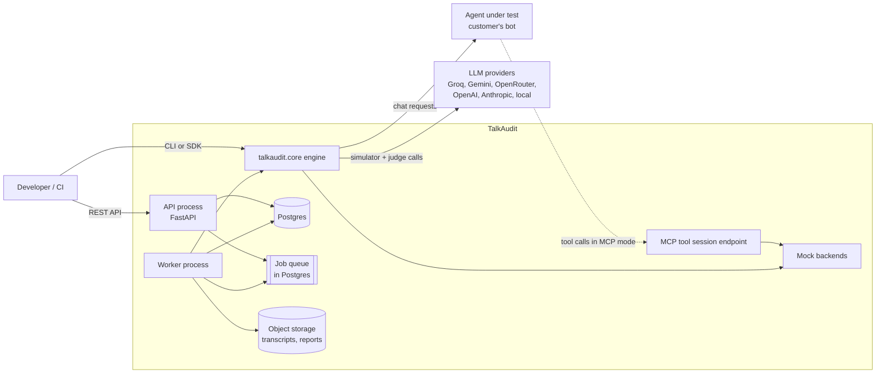
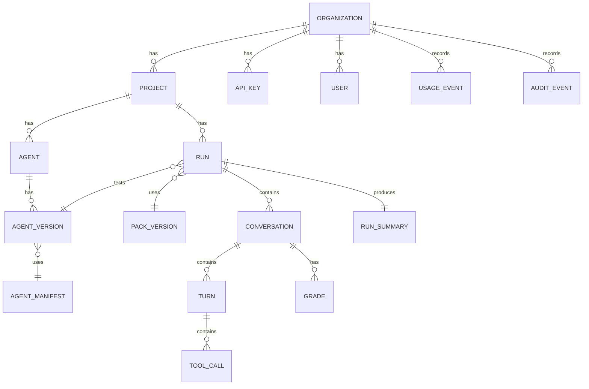

# 03 — Architecture and Design

## 1. Principles

1. **Core first.** All testing logic lives in one pure Python package (`talkaudit.core`). The CLI and the server are thin shells around it. If logic exists only in the server, it's in the wrong place.
2. **Modular monolith, not microservices.** One codebase, two process types (API and worker), clear module boundaries. Split into separate services only when a real load or team problem appears (see section 13).
3. **Multi-tenant from day one.** Every runtime object (run, conversation, turn, tool call, grade) carries `org_id`. Even the CLI uses a default local org. No retrofit later. Spec content (packs) belongs to no org; a private pack's owner is `packs.owner_org_id`.
4. **Ports and adapters.** Core depends on interfaces (LLM provider, storage, agent connector, clock, random). Implementations plug in. Tests use fakes.
5. **Specs are data.** Scenarios, personas, capabilities and manifests are versioned YAML validated by Pydantic schemas. No business content in code.
6. **Evidence over scores.** Every grade points to the turn or tool call that caused it.
7. **Reproducible by default.** Every run stores a manifest of versions, models and seeds.

## 2. System context



## 3. Repository layout

```
talkaudit/
  src/talkaudit/
    core/
      models/          # Pydantic domain models (Scenario, Persona, Run, Conversation, Turn, ToolCall, Grade)
      specs/           # YAML loaders, schema validation, pack versioning
      capabilities/    # Capability catalog, manifest mapping, ToolExecutor
      simulator/       # Customer simulator, prompt builder, fidelity checker
      noise/           # Deterministic noise engine + lexicons
      mock/            # Mock backends (banking first) with per-conversation state
      connectors/      # Agent connectors: sandbox, http_stateless, http_session, mcp_session, trace, outcome_only
      runner/          # Conversation loop, run orchestration, checkpointing
      grading/         # Graders: outcome, action, compliance, language_fit, sim_fidelity
      stats/           # Wilson CI, pass^k, pass@k, breakdowns, run diff
      llm/             # Provider-agnostic LLM client, retries, rate limiting, cost tracking
      reporting/       # JSON + Markdown reports
      ports.py         # Interfaces: LLMClient, Store, Clock, Rng, Connector, ToolExecutor, Grader
    cli/               # Typer CLI, local file store
    server/
      api/             # FastAPI routers, auth, schemas
      worker/          # Job loop, executes runs using core
      db/              # SQLAlchemy models, migrations (Alembic), repositories
      mcp_gateway/     # Per-conversation MCP endpoint backed by mock backends
      security/        # Secret encryption, SSRF guard, API key hashing
  packs/
    capabilities/      # e.g. banking.yaml
    personas/
    noise/
    scenarios/banking-core/
  tests/
    unit/  integration/  e2e/  fixtures/
  docs/
  docker/
  pyproject.toml
```

## 4. Module responsibilities

| Module | Owns | Must not |
|---|---|---|
| `models` | Data shapes and validation | Call LLMs, touch DB |
| `specs` | Loading and versioning YAML packs | Contain scenario content |
| `capabilities` | Translating capability ↔ agent tool names/args | Know about specific companies |
| `simulator` | Producing the next customer message | Grade anything |
| `noise` | Deterministic text transformations | Call LLMs |
| `mock` | Domain state machines, tool execution | Know about agents or connectors |
| `connectors` | Talking to the agent under test | Decide pass/fail |
| `runner` | Turn loop, stop conditions, checkpoints | Contain domain rules |
| `grading` | Pass/fail with evidence | Modify conversations |
| `stats` | Aggregation and comparison | Re-grade |
| `llm` | All LLM calls, retries, token accounting | Be bypassed. No direct SDK calls elsewhere |
| `server/*` | Tenancy, auth, persistence, jobs, HTTP | Contain testing logic |

## 5. Domain model



## 6. Database schema (Postgres)

All tables have `id UUID PK`, `org_id UUID NOT NULL` (except `organizations`), `created_at`, `updated_at`. Every query goes through a repository that requires `org_id`.

| Table | Key columns |
|---|---|
| `organizations` | name, slug, plan, retention_days, settings JSONB |
| `users` | email, role (owner/admin/member/viewer) |
| `api_keys` | name, prefix, hash (argon2), scopes, last_used_at, revoked_at |
| `projects` | name, description |
| `llm_credentials` | provider, encrypted_key, label (BYOK) |
| `agents` | project_id, name, connector_type, description |
| `agent_versions` | agent_id, version_label, connection_config JSONB, encrypted_secrets, manifest_id |
| `agent_manifests` | name, capability_catalog_ref, mapping JSONB, schema_version |
| `packs` | name (e.g. banking-core), visibility (public/private/holdout), owner_org_id nullable |
| `pack_versions` | pack_id, semver, content_hash, storage_ref, frozen bool |
| `runs` | project_id, agent_version_id, pack_version_id, status, config JSONB, manifest JSONB, seed, progress counts, started_at, finished_at, error |
| `conversations` | run_id, scenario_id, persona_id, repetition, status, stop_reason, turn_count, sim_invalid bool, tokens JSONB, transcript_ref |
| `turns` | conversation_id, index, role (customer/agent/tool), text, raw_text (pre-noise), latency_ms, meta JSONB |
| `tool_calls` | turn_id, capability, tool_name, args JSONB, normalized_args JSONB, result JSONB, source (harness/mcp/self_reported) |
| `grades` | conversation_id, grader, grader_version, passed bool, score float null, reason, evidence JSONB, judge_model null |
| `run_summaries` | run_id, metrics JSONB, breakdowns JSONB, warnings JSONB |
| `judge_gold_labels` | grader, item_id, conversation_ref, label, labeller |
| `judge_calibrations` | grader, judge_model, prompt_version, kappa, n, passed_gate |
| `jobs` | type, payload JSONB, status, attempts, run_after, locked_by, locked_at |
| `usage_events` | run_id, kind (conversation/llm_tokens), quantity, provider |
| `audit_events` | actor, action, target, ip, meta JSONB |
| `webhooks` | url, secret_hash, events[] |

Indexes: `(org_id, ...)` leading on every tenant table. Optional Postgres row-level security as a second layer once the server is stable.

Large text (full transcripts, reports) goes to object storage; DB holds refs plus the turn rows needed for querying.

## 7. Connectors (talking to the agent under test)

| Mode | Who runs tools | Who sees tool calls | Use case |
|---|---|---|---|
| `sandbox` | Harness, via ToolExecutor | Harness (exact) | Model benchmarks, leaderboard. Harness provides system prompt and tools |
| `mcp_session` | Agent, against TalkAudit mock tools via ToolExecutor | TalkAudit MCP gateway (exact) | Real agents that use MCP. Agent points its tool server at a per-conversation URL |
| `http_stateless` / `http_session` + `trace` | Agent, against its own backend or staging | Agent reports trace in response (self-reported) | Real agents with their own tools |
| `outcome_only` | Agent | Not visible | Black-box bots. Graded on transcript and optional state-check hook |

Each connector implements:

```python
class Connector(Protocol):
    async def start(self, ctx: ConversationContext) -> None: ...
    async def send(self, message: CustomerMessage) -> AgentReply: ...
    async def end(self) -> None: ...
    trust_level: Literal["exact", "self_reported", "none"]
```

`AgentReply` = text, list of `ToolCall` (if visible), `ended: bool`, latency, token usage (optional). Graders read `trust_level` and label results accordingly.

**Tool execution.** One `ToolExecutor` per conversation is the only thing that runs tools. It maps an agent tool call through the manifest to a capability, normalizes the arguments, executes the capability on the conversation's mock backend, records the call as `exact`, and answers in the agent's own argument names. The sandbox connector gets it through `ConversationContext` and runs the agent's tool loop itself (tool calls → results → agent, until a text reply), so `Connector` stays `start/send/end`. The MCP gateway uses the same executor, so both modes map, execute and record tools identically.

```python
class ToolExecutor(Protocol):
    def tools(self) -> list[ToolSpec]: ...                     # named and shaped per the agent manifest
    async def call(self, request: ToolRequest) -> ToolCall: ...  # map, execute, record
```

## 8. Capabilities and manifests

Scenarios never name a company's tools. They name capabilities from a catalog, for example `account.balance.get`, `card.block`, `complaint.create`.

An agent manifest maps capabilities to the agent's real tool names and argument names, with transforms:

- rename (`card.block` → `freeze_card`)
- argument mapping (`card_id` → `cardNumberMasked`)
- value transforms (amount in rupees → paisa)
- one-to-many (one capability satisfied by any of several tools)

The action grader always compares in capability space after normalizing through the manifest. See `07-SCENARIO-SPEC.md`.

## 9. Simulator design

Three layers:

1. **Planner (LLM).** Gets persona, scenario goal, known facts, hidden facts, conversation so far. Writes the next customer message as clean intent in the persona's language, with facts only as placeholders (`{amount_pkr}`). Also outputs structured state: `revealed_facts`, `goal_status` (pending/satisfied/gave_up), `wants_to_end`.
2. **Noise engine (deterministic).** Fills each placeholder with the fact rendered in one of the persona's amount or date styles, then applies the persona's noise profile with a seeded RNG: spelling variants from lexicon, vowel dropping, abbreviations, punctuation removal, typo injection, script mixing. Same seed gives same output. Raw and noised text are both stored.
3. **Fidelity checker.** Fast checks (rules) plus a small judge: does the planner output contain a fact value instead of a placeholder, is the message in the persona's language style, does it leak hidden facts not asked for, is it on goal, did it break character (e.g. mentions being an AI). On failure, regenerate up to 2 times; then mark conversation `sim_invalid`.

Facts that matter for grading (amounts, dates, IDs) are typed scenario data, never invented by the LLM. The planner only writes placeholders; the noise engine renders the values in persona-appropriate formats ("5k", "paanch hazar", "Rs.5000", "kal").

Simulator model is fixed per run and recorded. For leaderboard runs it is the same across all agents. The simulator and the reference agent always use different providers, so one model's habits don't shape both sides of a conversation.

## 10. Grading pipeline

Runs after each conversation ends (stream) and again at run end (aggregation):

1. `sim_fidelity` → if invalid, conversation excluded from agent metrics
2. `outcome` (deterministic, state assertions)
3. `action` (deterministic, constraints in capability space)
4. `compliance` (deterministic patterns first, calibrated judge second)
5. `language_fit` (calibrated judge, binary rubric)
6. `stats` aggregation, warnings, diff against baseline run if given

Graders are pure functions over a frozen `ConversationRecord`. Re-grading an old run with a new grader version is supported and creates new grade rows.

## 11. LLM layer

- One `LLMClient` interface: `complete(messages, model, tools?, response_schema?, temperature, seed?)`.
- Adapters, written on plain `httpx` with no provider SDKs: OpenAI-compatible (covers Groq, OpenRouter, Gemini's OpenAI-compatible endpoint, local Ollama), Anthropic native.
- Model IDs come from config, never from code.
- Built-in: retries with jittered backoff, per-provider concurrency semaphores, per-org limits, token and cost accounting into `usage_events`, response caching keyed by full request hash (dev and re-grading only).
- Structured outputs for planner and judges via JSON schema; invalid JSON retried once then fails loudly.

## 12. Reproducibility manifest

Stored on every run:

```json
{
  "talkaudit_version": "0.3.0",
  "pack": "banking-core@1.0.0", "pack_hash": "sha256:…",
  "personas_hash": "sha256:…", "noise_hash": "sha256:…",
  "simulator": {"provider": "groq", "model": "…", "temperature": 0.7},
  "judges": {"language_fit": {"model": "…", "prompt_version": "lf-2", "kappa": 0.78}},
  "connector": "mcp_session", "agent_version": "v12",
  "seed": 42, "repetitions": 3, "max_turns": 12
}
```

## 13. Why not microservices now, and when to split

Splitting into many services on day one costs a solo builder: network contracts between services, more deployments, distributed debugging, more infra bills, for no gain at zero users. What actually lets you serve many companies is tenant isolation, an async job queue, stateless API processes and horizontal workers. The modular monolith has all four.

Split a module into its own service when one of these happens:

| Signal | Split |
|---|---|
| MCP gateway traffic needs different scaling or network exposure | `mcp_gateway` as its own service |
| Voice processing needs GPUs or heavy audio libs | `voice` service |
| Judge/simulator calls dominate and need separate quotas | `llm-proxy` service |
| A bank requires part of the system inside their network | split along that boundary |

Because modules only talk through interfaces in `ports.py`, each split is a new adapter, not a rewrite.

## 14. Extension points

- New domain: capability catalog + mock backend + scenario pack
- New language: persona pack + noise lexicon + judge gold set
- New connector: implement `Connector`
- New grader: implement `Grader` and register with a version string
- Voice (later): connector that converts customer text to audio (TTS with accent options) and agent audio back to text (STT), plus audio-specific noise (background noise, call quality)
