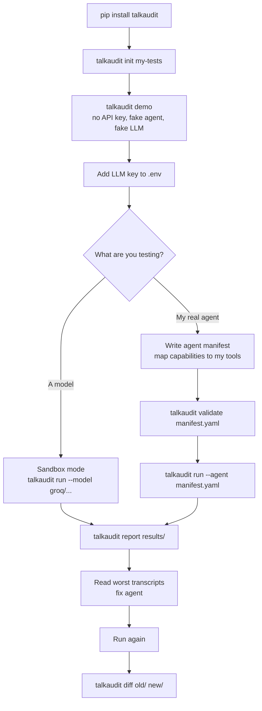
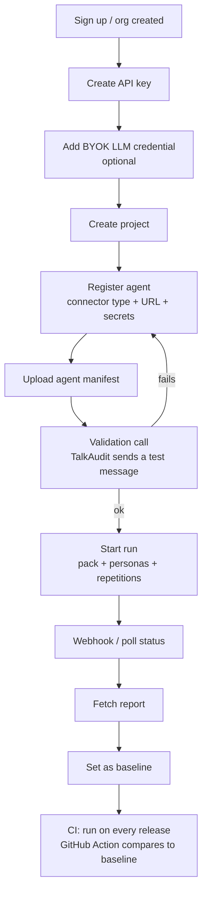
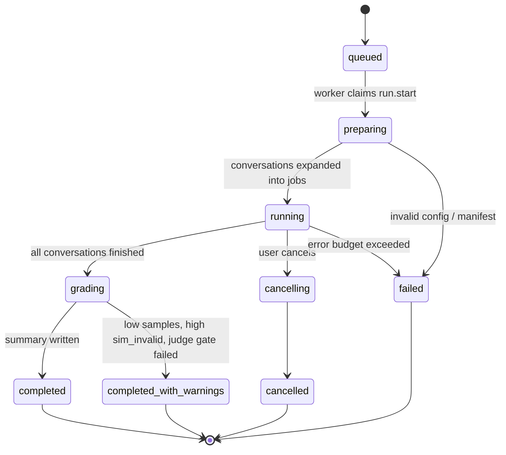
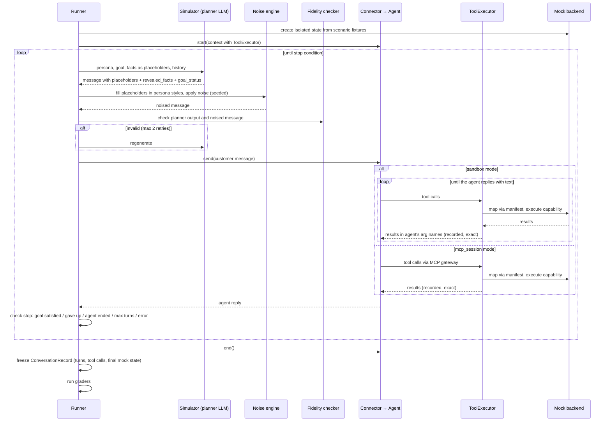
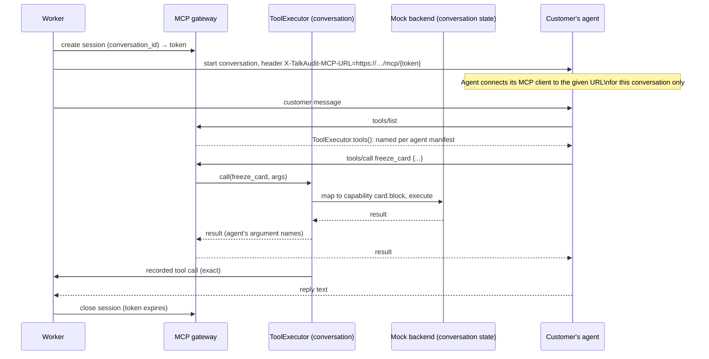
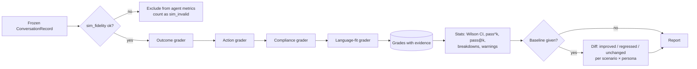
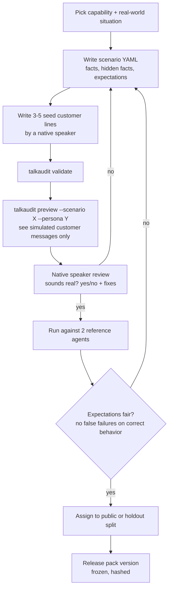
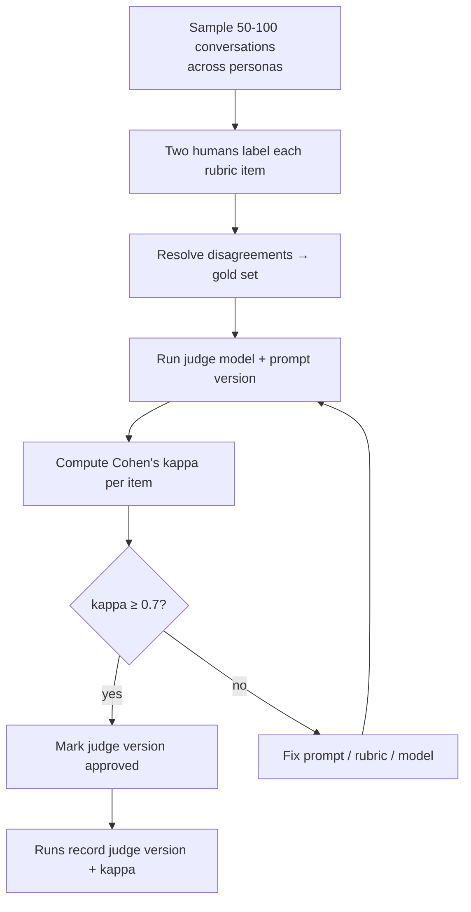
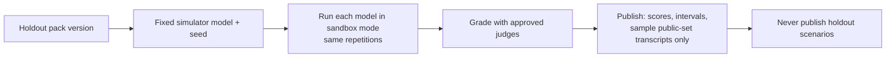

# 05 — Flows

All diagrams are Mermaid. They render on GitHub.

## 1. Developer flow: local CLI (open source)



## 2. Company flow: hosted platform



## 3. Run lifecycle (server)



Error budget: if more than 20% of conversations fail for infrastructure reasons (agent down, provider errors after retries), stop the run as `failed` rather than reporting misleading numbers.

## 4. Starting a run (sequence)

```mermaid
sequenceDiagram
  participant C as Client (CLI/CI/API user)
  participant API
  participant DB as Postgres
  participant W as Worker
  C->>API: POST /v1/runs {agent_version, pack, personas, repetitions}
  API->>API: auth, org scope, quota check
  API->>DB: insert run(status=queued), job run.start
  API-->>C: 202 {run_id}
  W->>DB: claim run.start
  W->>W: load pack version, manifest, personas; validate
  W->>DB: freeze manifest JSON on run
  W->>DB: insert conversations + conversation.execute jobs
  loop each conversation job
    W->>DB: claim conversation.execute
    W->>W: execute conversation (see 5)
    W->>DB: store turns, tool calls, grades
  end
  W->>DB: run.finalize: stats, summary, warnings
  W-->>C: webhook run.completed
```

## 5. Conversation loop



## 6. MCP session mode (testing a real agent's tool use)



The agent needs one small change: when `X-TalkAudit-MCP-URL` is present, use it as the tool server. Document this as a 10-line integration snippet per framework (LangGraph, OpenAI Agents SDK, plain MCP client).

## 7. Grading flow



## 8. Scenario authoring flow



## 9. Judge calibration flow



## 10. Leaderboard flow


